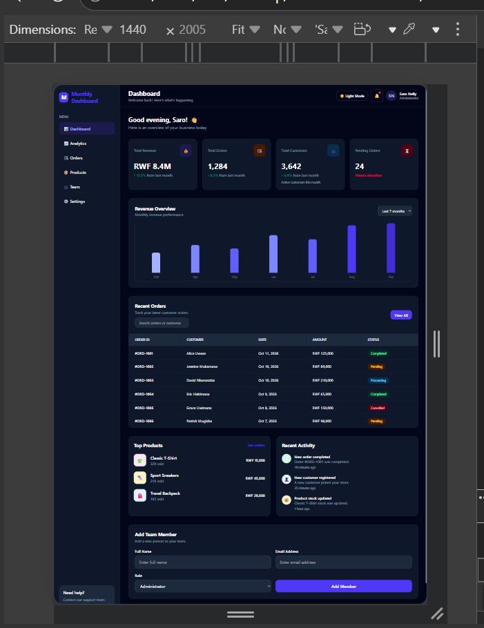
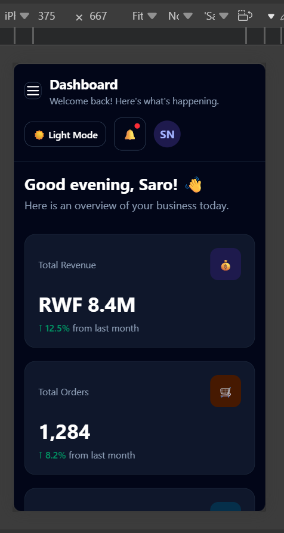

# Mintly Admin Dashboard — Week 3 Tailwind CSS

**Live site:** https://saronelly123-ui.github.io/week3-tailwind-dashboard/

A responsive admin dashboard for a fictional online store, built with HTML, JavaScript, and Tailwind CSS v4 using the official CLI.

## Features

- Responsive sidebar navigation with a working mobile menu toggle.
- Four KPI cards and a six-row orders table.
- Revenue chart, activity feed, and top products.
- Responsive layouts for mobile, tablet, laptop, and desktop.
- Order search and status filtering.
- CSV export for orders.
- Invitation form with validation.
- Dark/light mode toggle.
- Reusable component classes using `@apply` in `src/input.css`.

## Technologies Used

- HTML5
- Tailwind CSS v4
- JavaScript
- Node.js and npm
- Tailwind CSS CLI
- Git and GitHub Pages

## Screenshots

### Desktop View — 1440px



### Mobile View — 375px



## Run Locally

1. Install Node.js (LTS).
2. Open the project folder in VS Code.
3. Open the terminal and run:

   ```bash
   npm install
   ```

4. Build the Tailwind CSS file:

   ```bash
   npm run build
   ```

5. Open `index.html` using VS Code Live Server.

During development, you can run:

```bash
npm run dev
```

This watches your files and rebuilds the generated CSS when changes are detected.

## How I Customized Tailwind

I customized Tailwind CSS v4 to give Mintly a consistent visual identity instead of relying only on the default utility palette. In `src/input.css`, the `@theme` block defines a custom brand color scale using mint and green shades. These colors are used for primary buttons, active navigation, progress indicators, and positive accents. The Inter font family gives the dashboard a clean and readable appearance.

I also created reusable component classes inside `@layer components` using `@apply`. Classes such as `.card`, `.btn-primary`, `.btn-secondary`, `.badge`, `.nav-link`, and `.field` help maintain consistent styling across cards, buttons, navigation links, status labels, and form controls. This reduces repeated utility classes and makes future design changes easier. Tailwind utility classes and responsive prefixes such as `sm:`, `md:`, `lg:`, and `xl:` help the dashboard adapt to different screen sizes using a mobile-first approach.

## Responsive Checks

Test the dashboard at these viewport widths using browser DevTools:

- Mobile: 375px
- Tablet: 768px
- Laptop: 1024px
- Desktop: 1440px

The orders table should scroll horizontally on smaller screens without stretching the entire page.

## Deployment — GitHub Pages

1. Run `npm install`.
2. Run `npm run build` to generate `src/output.css`.
3. Push the project to GitHub.
4. Open the repository's **Settings → Pages**.
5. Under **Build and deployment**, select **Deploy from a branch**.
6. Choose the `main` branch and `/ (root)` folder, then save.
7. Wait for GitHub Pages to publish the site.

**Repository:** https://github.com/saronelly123-ui/week3-tailwind-dashboard/

## Git Workflow

Suggested feature branches for organizing development:

- `feature/dashboard-shell`
- `feature/orders-table`
- `feature/activity-panels`

For each feature, create a branch, make a focused change, commit your work, push the branch, and open a Pull Request. Review and merge the PR after checking the changes.

Suggested commit milestones:

1. `chore: initialize Tailwind CLI project`
2. `feat: define Mintly brand theme and component classes`
3. `feat: build responsive dashboard shell and sidebar`
4. `feat: add top bar and profile controls`
5. `feat: add responsive KPI cards`
6. `feat: build orders table with status badges`
7. `feat: add revenue chart and activity panel`
8. `feat: add top products and invite form`
9. `feat: add search filters and CSV export`
10. `docs: add setup, customization, and deployment guide`


